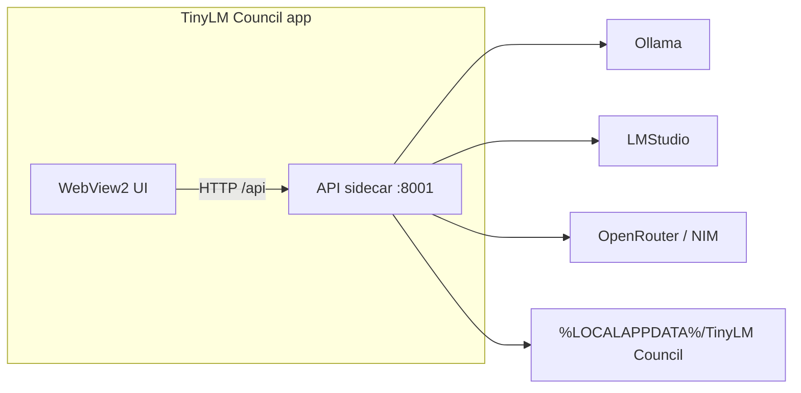

# TinyLM Council — Windows Desktop App (Tauri)

Native Windows app shell (WebView2) with the FastAPI backend bundled as a sidecar process.

## What you get

| Piece | Role |
|-------|------|
| **TinyLM Council.exe** / NSIS installer | Desktop window, taskbar icon, app lifecycle |
| **tinylm-council-api.exe** (sidecar) | Local FastAPI server on `127.0.0.1:8001` |
| **User data** | `%LOCALAPPDATA%\TinyLM Council\` (`settings.json`, `conversations\`, optional `.env`) |

Ollama, LM Studio, and cloud providers are **not** bundled. Install and run them separately, same as the web workflow.



## Install a release build

1. Install [WebView2](https://developer.microsoft.com/microsoft-edge/webview2/) if Windows prompts for it (Win11 usually has it).
2. Run the NSIS installer from GitHub Actions artifacts or a release.
3. Launch **TinyLM Council** from the Start menu.
4. Point Settings at Ollama (`localhost:11434`) or LM Studio (`localhost:1234`) and pick models.

Optional secrets can go in `%LOCALAPPDATA%\TinyLM Council\.env` (same keys as [`.env.example`](../.env.example)).

## Develop the desktop app

Requirements: Node.js 18+, Rust stable, Python 3.10+, and the usual project deps.

```powershell
# Terminal 1 is not needed — Tauri starts the API itself in desktop mode.
cd frontend
npm install
npm run desktop:dev
```

`desktop:dev` starts Vite and a native window. The Rust host spawns `uv run python -m backend.main` (or `python -m backend.main`) with `TINYLM_DESKTOP=1`.

The classic `.\start.ps1` browser workflow still works for non-desktop development.

## Build the Windows installer locally

```powershell
powershell -ExecutionPolicy Bypass -File .\scripts\pack-windows.ps1
```

This:

1. Freezes the API with PyInstaller (`scripts\build-sidecar.ps1`)
2. Stages `frontend\src-tauri\binaries\tinylm-council-api-x86_64-pc-windows-msvc.exe`
3. Runs `npm run desktop:build` (NSIS target)

Installer output:

`frontend\src-tauri\target\release\bundle\nsis\`

## CI

[`.github/workflows/windows-desktop.yml`](../.github/workflows/windows-desktop.yml) builds the NSIS installer on `windows-latest` and uploads it as an artifact.

## Notes

- The UI talks to `http://127.0.0.1:8001` inside the desktop shell.
- Closing the app stops the sidecar.
- macOS / Linux app bundles are out of scope for v1; the Tauri project can be extended later with additional `bundle.targets`.
