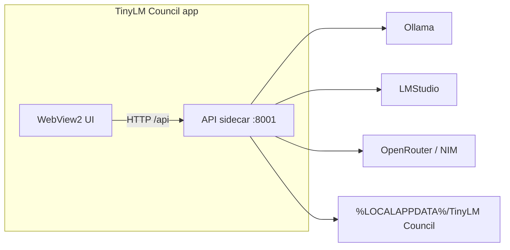

# TinyLM Council — Windows Desktop App (Tauri)

Native Windows app shell (WebView2) with the FastAPI backend bundled as a sidecar process. Prefer this over the Python/Node `start.ps1` flow if you just want to install and run.

## Download (GitHub Releases)

Grab the latest Windows installer from:

**[github.com/Tjjordan3/tinylm-council/releases](https://github.com/Tjjordan3/tinylm-council/releases)**

| Asset | What it is |
|-------|------------|
| `TinyLM-Council-Windows-Setup.exe` | Latest Windows NSIS installer (stable filename) |
| `TinyLM-Council-<version>-Windows-Setup.exe` | Same installer, versioned filename |

Tagged releases (`v*`) attach these automatically via CI. Pre-release / PR builds may only appear as [Actions artifacts](https://github.com/Tjjordan3/tinylm-council/actions/workflows/windows-desktop.yml).

## Install

1. Download the installer from the [Releases](https://github.com/Tjjordan3/tinylm-council/releases) page.
2. Run it (Windows may prompt for [WebView2](https://developer.microsoft.com/microsoft-edge/webview2/) — Win11 usually has it already).
3. Launch **TinyLM Council** from the Start menu.
4. Install [Ollama](https://ollama.com/) and/or [LM Studio](https://lmstudio.ai/) separately, then complete the in-app setup wizard.

Optional secrets can go in `%LOCALAPPDATA%\TinyLM Council\.env` (same keys as [`.env.example`](../.env.example)).

## What you get

| Piece | Role |
|-------|------|
| **TinyLM Council.exe** / NSIS installer | Desktop window, taskbar icon, app lifecycle |
| **tinylm-council-api.exe** (sidecar) | Local FastAPI server on `127.0.0.1:8001` |
| **User data** | `%LOCALAPPDATA%\TinyLM Council\` (`settings.json`, `conversations\`, optional `.env`) |

Ollama, LM Studio, and cloud providers are **not** bundled. Install and run them separately.



## First-time configuration

Same as the web app:

1. Complete the **setup wizard** (Ollama-only is fine).
2. In **Settings**, pick **Tiny** profile, enable 2+ models, choose a chairman, save.
3. Ask a short test question.

See [WINDOWS_SETUP.md](WINDOWS_SETUP.md) for provider tips, Tailscale phone access (via the classic browser launcher), and troubleshooting.

## Debate mode (summary)

From **v0.7.0**, the desktop app includes **Debate** deliberation alongside ranked peer review.

| Step | What happens |
|------|----------------|
| **1. First opinions** | Each council member answers your question. |
| **2. Debate** | Members rebut each other for 1–3 anonymized rounds and revise their answers. |
| **3. Final answer** | The chairman synthesizes a consensus from the initials + debate. |

Enable it under **Settings → Deliberation mode → Debate**, or use the chat **Mode** dropdown for one message. Full notes: [WINDOWS_SETUP.md — Debate mode](WINDOWS_SETUP.md#debate-mode-summary).

## Develop the desktop app

Requirements: Node.js 18+, Rust stable, Python 3.10+, and the usual project deps.

```powershell
cd frontend
npm install
npm run desktop:dev
```

`desktop:dev` starts Vite and a native window. The Rust host spawns `uv run python -m backend.main` (or `python -m backend.main`) with `TINYLM_DESKTOP=1`.

The classic `.\start.ps1` browser workflow still works for non-desktop development.

## Build the Windows installer locally

```powershell
powershell -ExecutionPolicy Bypass -File .\scripts\pack-windows.ps1
```

This:

1. Freezes the API with PyInstaller (`scripts\build-sidecar.ps1`)
2. Stages `frontend\src-tauri\binaries\tinylm-council-api-x86_64-pc-windows-msvc.exe`
3. Runs `npm run desktop:build` (NSIS target)

Installer output:

`frontend\src-tauri\target\release\bundle\nsis\`

## CI and releases

[`.github/workflows/windows-desktop.yml`](../.github/workflows/windows-desktop.yml):

- Builds the NSIS installer on `windows-latest`
- Uploads a workflow artifact on PRs
- On `v*` tags, attaches `TinyLM-Council-Windows-Setup.exe` (and a versioned copy) to the GitHub Release

## Notes

- The UI talks to `http://127.0.0.1:8001` inside the desktop shell.
- Closing the app stops the sidecar.
- macOS / Linux app bundles are out of scope for v1; the Tauri project can be extended later with additional `bundle.targets`.
